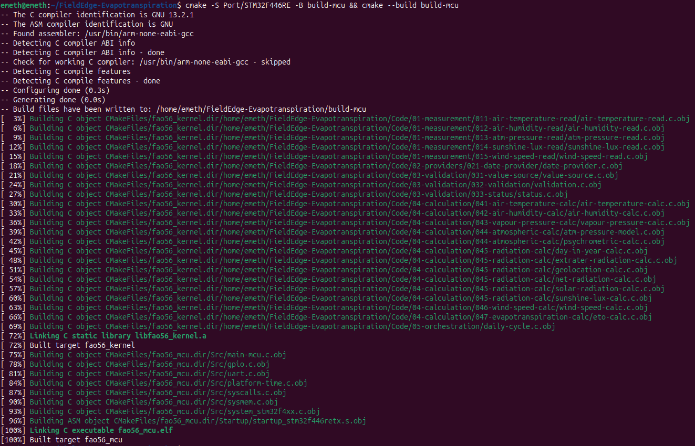
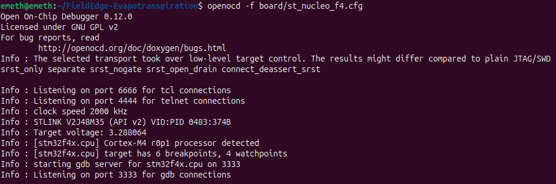
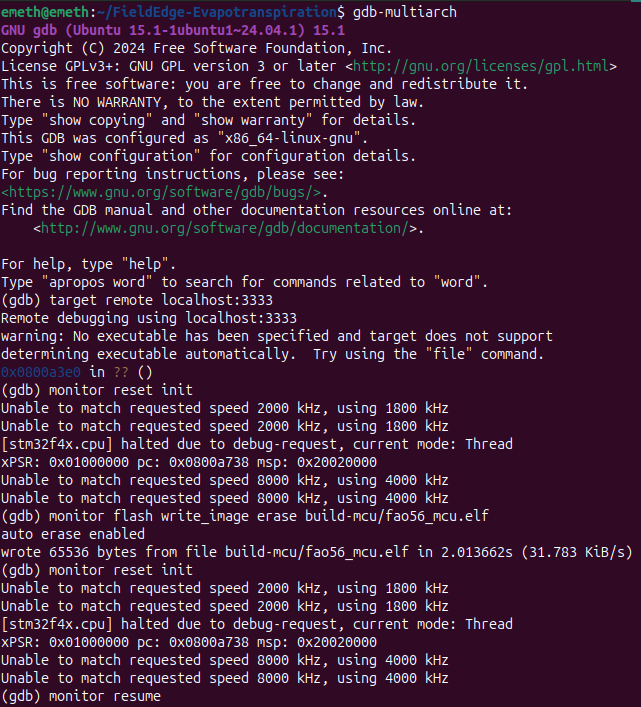
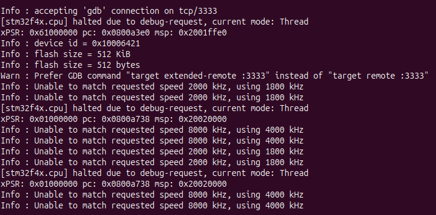
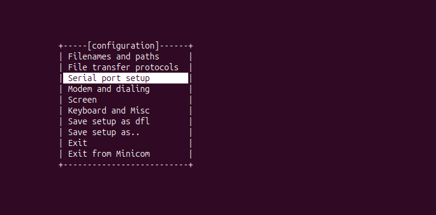
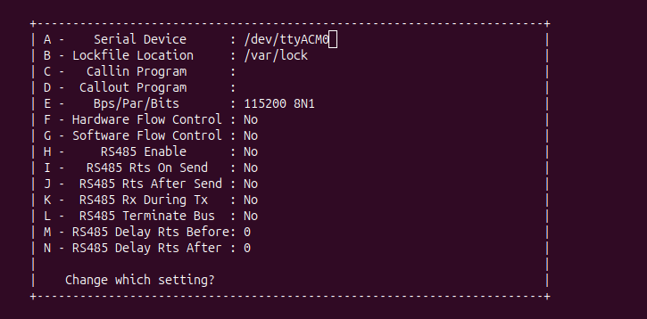
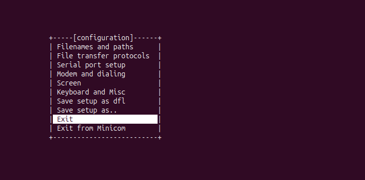
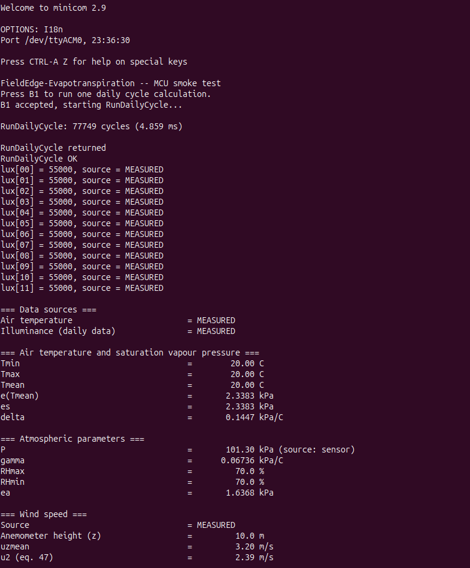
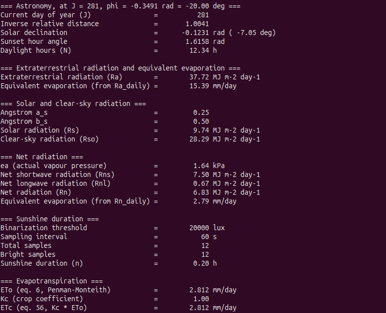

# devlog20. Подготовка предшествующего кода к портированию и smoke-тест

*First run of the calculation kernel on real hardware (STM32F446RET6 Nucleo-64, Cortex-M4F). Describes the minimal platform layer, a new `fao56_mcu` CMake target cross-compiled with `arm-none-eabi-gcc` through a toolchain file (with CI building the firmware), and flashing/debugging with OpenOCD and GDB.*

* * *

### Реорганизуем структуру проекта

Каталог вычислительного ядра (v0.1.x) `Code/` будет оставаться *насколько возможно* нетронутым на всех последующих этапах разработки (v0.2.x). Исключением может быть, разве что, рефакторинг самого вычислительного ядра либо что-то еще, о чем мы сейчас сказать не можем.

Создадим для всего, что касается **портирования** вычислительной основы нашего проекта, каталог `Port/`:

```
FieldEdge-Evapotranspiration/
├── Code/
│   ├── 01-measurement/
│   ├── 02-providers/
│   ├── 03-validation/
│   ├── 04-calculation/
│   ├── 05-orchestration/
│   ├── 06-test/
│   └── CMakeLists.txt
│
├── Port/
│   └── STM32F446RE/
│       ├── CMakeLists.txt
│       ├── arm-none-eabi.cmake
│       ├── Inc/
│       ├── Src/
│       ├── CMSIS/
│       ├── Startup/
│       └── STM32F446RETX_FLASH.ld
│
├── Docs/
└── .github/
```

* * *

### Напишем драйверы для периферийных устройств

Мы хотим, чтобы вычисление эталонной эвапотранспирации запускалось на МК при нажатии пользовательской кнопки B1 (active low на плате Nucleo). Кроме того, для вспомогательного сигнала при успешной обработке нажатия пусть переключается пользовательский светодиод LD2 на плате Nucleo. Портируем вычислительное ядро на **STM32F446RET6 Nucleo-64**.

Мы хотим получать результат вычислений в терминал хост-ПК, в нашем случае для вывода результата будет использоваться Minicom (Linux). Таким образом, нужно написать IO-драйвер для светодиода и кнопки, а также драйвер УАПП для передачи данных в терминал хост-ПК. Будем *пока что* использовать системные файлы STMicroelectronics и библиотеку CMSIS.

* * *

#### **`gpio.h`**

```C
#include <stdbool.h>
#include "stm32f4xx.h"

void LD_Init(void);
void LD_On(void);
void LD_Off(void);
void LD_Toggle(void);
void BTN_Init(void);
bool BTN_State(void);
```

#### **`gpio.c`**

```C
#include "gpio.h"

#define GPIOAEN  (1U << 0)
#define GPIOCEN  (1U << 2)
#define LD_BS5   (1U << 5)
#define LD_BR5   (1U << 21)
#define BTN_PIN  (1U << 13)
#define LD_PIN   (1U << 5)

void LD_Init(void) {
    RCC->AHB1ENR |=  GPIOAEN;
    GPIOA->MODER |=  (1U << 10);
    GPIOA->MODER &= ~(1U << 11);
}

void LD_On(void) {
    GPIOA->BSRR |= LD_BS5;
}

void LD_Off(void) {
    GPIOA->BSRR |= LD_BR5;
}

void LD_Toggle(void) {
    GPIOA->ODR  ^= LD_PIN;
}

void BTN_Init(void) {
    RCC->AHB1ENR |=  GPIOCEN;
    GPIOC->MODER &= ~(1U << 26);
    GPIOC->MODER &= ~(1U << 27);
}

/* B1 is active low */
bool BTN_State(void) {
    if (GPIOC->IDR & BTN_PIN) {
        return false;
    } else {
        return true;
    }
}
```

* * *

#### **`uart.h`**

```C
#include "stm32f4xx.h"
void UART_Init(void);
```

#### **`uart.c`**

```C
#include <stdint.h>
#include "uart.h"

#define GPIOAEN   (1U << 0)
#define UART2EN   (1U << 17)

#define BAUDRATE  (115200)
#define FREQ      (16000000)
#define APB1_CLK  FREQ

#define CR1_TE    (1U << 3)
#define CR1_UE    (1U << 13)
#define SR_TXE    (1U << 7)

static void UART_SetBaudrate(uint32_t periph_clk, uint32_t baudrate);
static void UART_Write(int ch);

int __io_putchar(int ch) {
    if (ch == '\n') {
        UART_Write('\r');  // Пригодится для вывода в Minicom
    }
    
    UART_Write(ch);
    return ch;
}

void UART_Init(void) {
    RCC->AHB1ENR  |=  GPIOAEN;
    GPIOA->MODER  &= ~(1U << 4);
    GPIOA->MODER  |=  (1U << 5);
    GPIOA->AFR[0] |=  (1U << 8);
    GPIOA->AFR[0] |=  (1U << 9);
    GPIOA->AFR[0] |=  (1U << 10);
    GPIOA->AFR[0] &= ~(1U << 11);

    RCC->APB1ENR  |=  UART2EN;
    UART_SetBaudrate(APB1_CLK, BAUDRATE);
    USART2->CR1    =  CR1_TE;
    USART2->CR1   |=  CR1_UE;
}

static void UART_Write(int ch) {
    while (!(USART2->SR & SR_TXE)) {}
    USART2->DR = (ch & 0xFF);
}

static uint16_t UART_ComputeBaudrate(uint32_t periph_clk, uint32_t baudrate) {
    return((periph_clk + (baudrate / 2U)) / baudrate);
}

static void UART_SetBaudrate(uint32_t periph_clk, uint32_t baudrate) {
    USART2->BRR = UART_ComputeBaudrate(periph_clk, baudrate);
}
```

* * *

### Напишем файл основной функции

Стоит отметить, что этот, третий по счету, файл основной функции будет относиться к отдельной цели сборки - `fao56_mcu` - наряду с целями `fao56_app` (для вычислительного ядра) и `fao56_test` (для тестов вокруг вычислительного ядра).

Воспользуемся случаем и узнаем сразу же *предварительное* количество тактов процессора и миллисекунд вокруг выполнения функции `RunDailyCycle()` - для этого применим инструкции Data Watchpoint and Trace (DWT) и настроим регистр аппаратного счетчика циклов `CYCCNT` (cycle counter and related timers). Подробнее см.: Armv7-M Architecture Reference Manual, February 2021; раздел C1 Armv7-M Debug, подразделы [CYCCNT cycle counter and related timers](https://support.arm.com/documentation/ddi0403/d/Debug-Architecture/ARMv7-M-Debug/The-Data-Watchpoint-and-Trace-unit/CYCCNT-cycle-counter-and-related-timers), [Cycle Count register, DWT_CYCCNT](https://support.arm.com/documentation/ddi0403/d/Debug-Architecture/ARMv7-M-Debug/The-Data-Watchpoint-and-Trace-unit/Cycle-Count-register--DWT-CYCCNT). В рамках smoke-теста сделаем это изнутри основной функции.

Напишем файл **`main-mcu.c`** следующим образом:

```C
#include <stdio.h>
#include "gpio.h"
#include "uart.h"
#include "05-orchestration/daily-cycle.h"
#include "03-validation/033-status/status.h"

int main(void) {
    /* Data Watchpoint & Trace: for smoke test only */
    CoreDebug->DEMCR |= CoreDebug_DEMCR_TRCENA_Msk;
    DWT->CYCCNT = 0;
    DWT->CTRL  |= DWT_CTRL_CYCCNTENA_Msk;

    UART_Init();
    LD_Init();
    BTN_Init();

    static DailyResults results;
    const char *failed_step = "unknown";

    printf("FieldEdge-Evapotranspiration -- MCU smoke test\n");
    printf("Press B1 to run one daily cycle calculation.\n");

    while (1) {
        if (BTN_State()) {
            while (BTN_State()) {}

            printf("B1 accepted, starting RunDailyCycle...\n");
            LD_Toggle();

            uint32_t cycles_start = DWT->CYCCNT;

            const Status status = RunDailyCycle(&results, &failed_step);

            uint32_t cycles_elapsed = DWT->CYCCNT - cycles_start;
            printf("\nRunDailyCycle: %lu cycles (%.3f ms)\n",
                (unsigned long)cycles_elapsed, (float)cycles_elapsed / 16000.0f);

            printf("\nRunDailyCycle returned\n");

            if (status != STATUS_OK) {
                printf("RunDailyCycle failed at %s: %s\n",
                    failed_step, Status_ToString(status));
            } else {
                printf("RunDailyCycle OK\n");
                PrintReport(&results);
            }
        }
    }
}
```

> Поначалу мы запускали программу и проводили тесты в среде STM32CubeIDE и забыли подключить в сборку файл `system_stm32f4xx.c`. По умолчанию доступ к сопроцессорам FPU (CP10, CP11) отключен в целях энергосбережения, и при первом же обращении программы к FPU происходит HardFault. Поначалу в ходе тестирования других компонентов программы мы включали доступ к FPU прямо в теле основной функции `main()` - через регистр `CPACR`; подробнее см.: STM32 PM0214 Rev 10, March 2020: 253; раздел 4.6.1 Coprocessor access control register (CPACR). В нашей сборке через CMake такое "ручное" включение теперь не нужно: компиляция с `-mfloat-abi=hard` определяет `__FPU_USED` (как было и в STM32CubeIDE), и стандартная функция `SystemInit()` из `system_stm32f4xx.c` открывает доступ к FPU еще до входа в функцию `main()`.

* * *

### Напишем временный файл для работы функций времени

Основной проблемой для запуска кода v0.1.x прямо на МК - и это можно выяснить при использовании отладчика - является вызов функций времени, в частности, в функции `DateProvider_Read` и в функциях всех модулей слоя измерений, где используются структуры с полем `timestamp` и инструкция вида `out_sample->timestamp = (uint32_t)time(NULL);`.

В каталоге исходного кода `Src/`, находящемся внутри `Port/` создадим *временный* файл `platform-time.c`, где введем фиксированное время `2026-10-08 12:00:00 UTC`, используя его репрезентацию через знаковый тип `long`: `1791460800L`. В дальнейшем - за пределами smoke-теста - этот файл будет не нужен, и мы будем работать с RTC.

#### **`platform-time.c`**

```C
#include <stddef.h>
#include <time.h>
#include <errno.h>
#include <sys/time.h>

/* newlib time source for the STM32 smoke test */
int _gettimeofday(struct timeval *tv, void *tz) {
    (void)tz;

    if (tv == NULL) {
        errno = EINVAL;  /* Invalid argument */
        return -1;
    }

    /* Smoke test only: 2026-10-08 12:00:00 UTC; replace with RTC later */
    tv->tv_sec = (time_t)1791460800L;  /* Signed */
    tv->tv_usec = 0;

    return 0;
}
```

* * *

### Создадим и опишем новую цель сборки

Новая цель будет собираться подходящим для этого компилятором. Файлы для сборки этой цели будут находиться непосредственно **в каталоге `Port/`**. Сборка будет использовать как файлы собственного каталога - драйверы и системные файлы для работы с МК, - так и файлы исходного кода вычислительного ядра из каталога `Code/` (где находится свой собственный `CMakeLists.txt` для сборки вычислительного ядра и тестирования).

#### **`arm-none-eabi.cmake`**

```CMake
set(CMAKE_SYSTEM_NAME Generic)
set(CMAKE_SYSTEM_PROCESSOR arm)

set(CMAKE_C_COMPILER arm-none-eabi-gcc)
set(CMAKE_ASM_COMPILER arm-none-eabi-gcc)

set(CMAKE_TRY_COMPILE_TARGET_TYPE STATIC_LIBRARY)
```

#### **`CMakeLists.txt`**

```CMake
cmake_minimum_required(VERSION 3.31)

if(NOT CMAKE_TOOLCHAIN_FILE)
    set(CMAKE_TOOLCHAIN_FILE "${CMAKE_CURRENT_LIST_DIR}/arm-none-eabi.cmake")
endif()

project(fao56_mcu C ASM)

set(CMAKE_C_STANDARD 11)
set(CMAKE_C_STANDARD_REQUIRED ON)
set(CMAKE_C_EXTENSIONS OFF)
set(CMAKE_C_FLAGS_RELEASE "-Os")

set(PORT_DIR "${CMAKE_CURRENT_LIST_DIR}")
get_filename_component(CODE_DIR "${PORT_DIR}/../../Code" ABSOLUTE)

# Kernel sources. Host main() and tests are not included
file(GLOB_RECURSE FAO56_CORE_SOURCES CONFIGURE_DEPENDS
        "${CODE_DIR}/01-measurement/*.c"
        "${CODE_DIR}/02-providers/*.c"
        "${CODE_DIR}/03-validation/*.c"
        "${CODE_DIR}/04-calculation/*.c"
)
list(APPEND FAO56_CORE_SOURCES "${CODE_DIR}/05-orchestration/daily-cycle.c")

set(MCU_CPU_FLAGS -mcpu=cortex-m4 -mthumb -mfpu=fpv4-sp-d16 -mfloat-abi=hard)

add_library(fao56_kernel STATIC ${FAO56_CORE_SOURCES})
target_compile_options(fao56_kernel PRIVATE
        ${MCU_CPU_FLAGS} -ffunction-sections -fdata-sections
        -Wall -Wextra -Wpedantic -Wfloat-equal -Wconversion -Wshadow -Werror
)
set_target_properties(fao56_kernel PROPERTIES C_EXTENSIONS OFF)

set(STARTUP_FILE "${PORT_DIR}/Startup/startup_stm32f446retx.s")
set_source_files_properties("${STARTUP_FILE}" PROPERTIES
        COMPILE_OPTIONS "-x;assembler-with-cpp")

add_executable(fao56_mcu
        "${PORT_DIR}/Src/main-mcu.c"
        "${PORT_DIR}/Src/gpio.c"
        "${PORT_DIR}/Src/uart.c"
        "${PORT_DIR}/Src/platform-time.c"
        "${PORT_DIR}/Src/syscalls.c"
        "${PORT_DIR}/Src/sysmem.c"
        "${PORT_DIR}/Src/system_stm32f4xx.c"
        "${STARTUP_FILE}"
)
set_target_properties(fao56_mcu PROPERTIES SUFFIX ".elf")

target_include_directories(fao56_mcu PRIVATE
        "${PORT_DIR}/Inc"
        "${PORT_DIR}/CMSIS/Include"
        "${PORT_DIR}/CMSIS/Device/ST/STM32F4xx/Include"
        "${CODE_DIR}"
)
target_compile_definitions(fao56_mcu PRIVATE STM32F446xx)
target_compile_options(fao56_mcu PRIVATE
        ${MCU_CPU_FLAGS} -ffunction-sections -fdata-sections -Wall -Wextra)

target_link_options(fao56_mcu PRIVATE
        ${MCU_CPU_FLAGS}
        "-T${PORT_DIR}/STM32F446RETX_FLASH.ld"
        --specs=nano.specs --specs=nosys.specs
        -Wl,--gc-sections
        -Wl,-u,_printf_float
        "-Wl,-Map=${CMAKE_CURRENT_BINARY_DIR}/fao56_mcu.map"
)
target_link_libraries(fao56_mcu PRIVATE fao56_kernel m)
```

* * *

## Сборка, прошивка, smoke-тест

Легко можно провести тестирование, собрав проект и запустив на МК через отладчик прямо из STM32CubeIDE или разместив бинарный файл через STM32CubeProgrammer. Мы уже это сделали. Представляется важным разместить в открытом доступе средства для возможности "ручной" сборки.

### Сборка

В корневом каталоге `FieldEdge-Evapotranspiration` зададим инструкцию:

```bash
cmake -S Port/STM32F446RE -B build-mcu && cmake --build build-mcu
```



> В таком случае следует добавить упоминание каталога `build-mcu` в список исключений в файле `.gitignore`.

* * *

### Прошивка

С отладчиком GDB мы уже поработали ранее в среде STM32CubeIDE, это было увлекательно, и здесь едва ли можно привести историю исследования. Как уже сказано, в основном была обнаружена проблема с вызовом функции времени. Здесь мы приведем лишь рутинную последовательность процесса прошивки (flashing) с использованием OpenOCD и GDB.

Сперва следует подключить плату МК к хост-ПК.

Нам потребуется **две отдельные сессии терминала**. Будем выполнять их из того же самого расположения - из корневого каталога `FieldEdge-Evapotranspiration`.

**В первой сессии** введем инструкцию:

```bash
openocd -f board/st_nucleo_f4.cfg
```



* * *

**Во второй сессии** введем:

```bash
arm-none-eabi-gdb
```

Либо:

```bash
gdb-multiarch
```

Затем введем инструкцию с номером порта, который указан в выводе OpenOCD, и подключимся к МК:

```
(gdb) target remote localhost:3333
```

Выполним сброс/инициализацию:

```
(gdb) monitor reset init
```

Выполним прошивку (flashing):

```
(gdb) monitor flash write_image erase build-mcu/fao56_mcu.elf
```

Снова сброс:

```
(gdb) monitor reset init
```

Возобновим выполнение программы на МК:

```
(gdb) monitor resume
```



В окне первой сессии (OpenOCD) см.:



* * *

### Smoke-тест

Параллельно предыдущим этапам работы либо сразу после них создадим еще одну сессию для работы в терминале. Вызовем и настроим Minicom:

```bash
sudo minicom -s
```

  
  


Или прямо так:

```bash
minicom -D /dev/ttyACM0 -b 115200
```

Окажемся внутри экрана Minicom:

```
Welcome to minicom 2.9

OPTIONS: I18n                                                              
Port /dev/ttyACM0, 23:36:30                                                  
Press CTRL-A Z for help on special keys   
```

Выполним аппаратный сброс через кнопку B2 на плате Nucleo и увидим на экране приветственное сообщение и приглашение, которые мы описали в файле основной функции:

```
FieldEdge-Evapotranspiration -- MCU smoke test    
Press B1 to run one daily cycle calculation.
```

Последуем приглашению и нажмем пользовательскую кнопку B1 на плате Nucleo.

  


> Обратим внимание вновь на то, что в smoke-тесте используются фиксированные дата и время. Для 8 октября невисокосного года порядковый номер дня в году равен 281. Обратим внимание на значение счетчика: `RunDailyCycle: 77749 cycles (4.859 ms)` при тактовой частоте 16 МГц. Учитывая, что вычисление эвапотранспирации согласно базовому сценарию выполняется один раз в сутки, предположим, что скорость вычислений *прямо сейчас* не является причиной менять `double` на `float`. Разумеется, расходы возрастут по мере разработки проекта, кроме того, предложенный метод измерений вообще не следует считать адекватным или исчерпывающим в рамках поставленной проблемы.

Некоторые **итоги** состоят в том, что **вычислительное ядро выполняется на Cortex-M4F без изменений в расчетной части и основных алгоритмах**.

* * *

## Автоматизация CI

Создадим в каталоге `.github/workflows` файл для автоматизации сборки `mcu-build.yml` и опишем его.

```yaml
name: MCU Build

on:
  push:
    paths: ['Code/**', 'Port/**', '.github/workflows/mcu-build.yml']
  pull_request:
    paths: ['Code/**', 'Port/**', '.github/workflows/mcu-build.yml']

jobs:
  mcu-build:
    runs-on: ubuntu-latest
    strategy:
      matrix:
        build_type: [Debug, Release]

    steps:
      - name: Get source code
        uses: actions/checkout@v6

      - name: Install ARM GNU toolchain
        run: |
          sudo apt-get update
          sudo apt-get install -y gcc-arm-none-eabi binutils-arm-none-eabi \
            libnewlib-arm-none-eabi

      - name: Configure STM32 target
        run: cmake -S Port/STM32F446RE -B build-mcu -DCMAKE_BUILD_TYPE=${{ matrix.build_type }}

      - name: Build STM32 firmware
        run: cmake --build build-mcu --parallel

      - name: Memory usage
        run: arm-none-eabi-size build-mcu/fao56_mcu.elf
```
