# devlog21. RTC драйвер, разработка консоли и тесты

*This devlog documents the implementation and verification of the RTC/time subsystem for the STM32F446RE port. It covers UTC timekeeping using LSE, trusted-time validation, host-assisted time setting over UART, and integration with the daily calculation. It also records firmware build and hardware checks, followed by errata-driven RTC updates and replacement of the PC13/B1 calculation trigger with a UART `RUN` command.*

* * *

## Что было сделано

- Интерфейс источника времени (`TimeProvider`) и календарные преобразования UTC timestamp <-> Gregorian calendar.

- Механизм получения календарной даты (станции) с учетом фиксированного смещения относительно UTC.

- Аппаратный RTC-драйвер для STM32F446RE с использованием внешнего кварца LSE 32.768 кГц; инициализация, проверка конфигурации тактирования, контроль хода часов, чтение и запись календаря, проверки достоверности времени и защита от "отката" даты.

- Механизм эксплицитной первичной установки UTC через UART (`SET-UTC`) с аппаратной проверкой записанного значения; Python-утилита для синхронизации RTC с часами хост-компьютера.

- UART service console с командами `TIME`, `SET-UTC` и `RUN`; проверка достоверности RTC перед запуском дневного вычислительного цикла.

- Измерение времени выполнения `RunDailyCycle()` через DWT cycle counter; вывод временных меток, даты станции и результатов вычисления.

- Сборка, проверка установки и хода RTC, проверка сохранения доверенного времени после обычного сброса, а также аппаратный smoke test вычислительного цикла на STM32F446RE Nucleo-64 board.

- Дополнительные изменения - на основе STM32F446 ES0298 Rev 8 - в RTC-драйвер; способ управления вычислением; кнопка B1 (PC13) заменена UART-командой `RUN` из-за возможного влияния переключений PC13 на частоту LSE.

* * *

## Сборка и минимальные проверки

### STM32CubeIDE

Соберем проект и запустим в режиме отладки через STM32CubeIDE, глядя параллельно на вывод в Minicom-терминале.

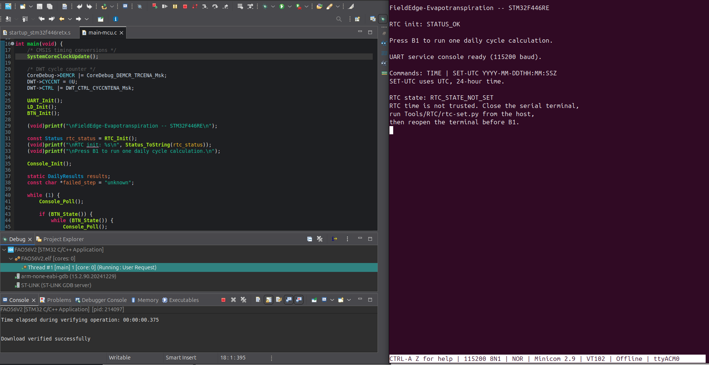

Видим по сообщениям в терминале, что время не установлено. Попробуем запустить вычисление, нажав на пользовательскую кнопку B1 на плате.


Вычисление не может быть начато без предварительной установки времени. Обратимся к совету: закроем на время сеанс Minicom-терминала, запустим Python-скрипт установки времени и снова откроем Minicom. Следует выполнять эти операции последовательно потому, чтобы для выполнения одной операции com-порт не был занят другой операцией. Сеанс отладки можно не прерывать.

Итак, мы закрыли сеанс Minicom, открыли новый сеанс терминала из каталога, находящегося на уровень выше папок `Code/`, `Port/`, `Tools/`, и выполнили команду запуска Python-скрипта (он может быть запущен из `venv`):

```bash
python3 Tools/RTC/rtc-set.py --port /dev/ttyACM0
```

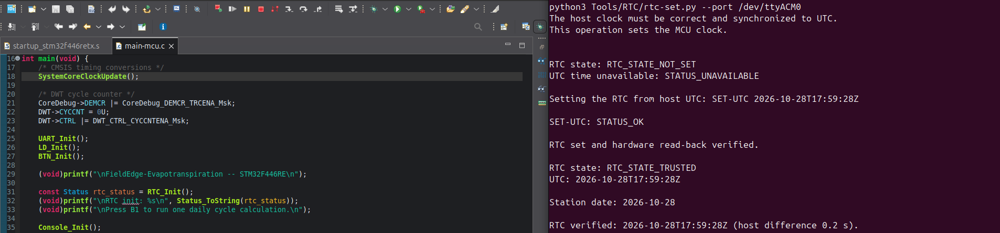

Видим, что время было передано от хост-машины к микроконтроллеру и успешно установлено. Откроем снова Minicom-терминал и введем `TIME` - команду, которая запрашивает текущее время у модуля RTC микроконтроллера. Стоит иметь в виду, что команда `TIME` печатается в терминале "невидимо" - передаваемые символы не отображаются в графическом пользовательском интерфейсе терминала хост ПК.

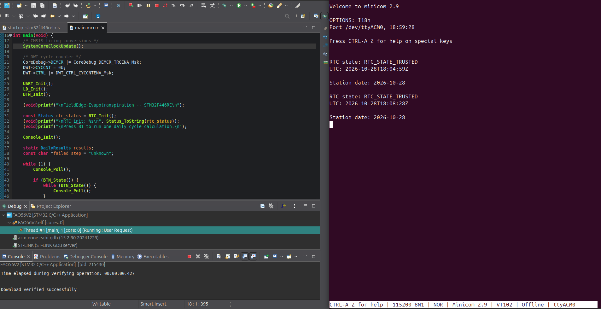

На последнем снимке видим, что время открытия Minicom различается на час со временем вызова RTC драйвера (вызов времени `TIME` сделан дважды - чтобы показать что часы изменяются). Это связано с тем, что RTC настроен на передачу UTC, а ПК выставлен в локальное время: так и должно быть - настройка локального времени задается через конфигурацию смещения к UTC в файле конфигурации развертки системы `deployment-config.h`.

Теперь запустим вычисление, нажав пользовательскую кнопку B1.

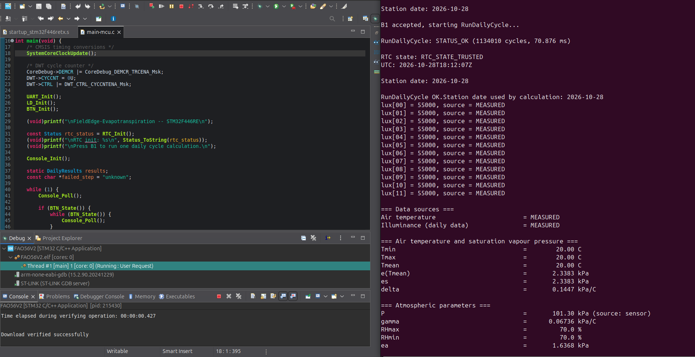  
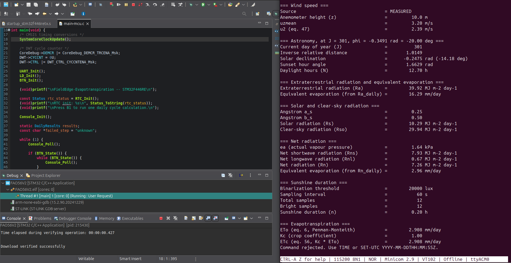

Видим, что процесс вычисления начался с обработки нажатия и выполнился успешно. Внизу видим строку, после блока вычислений, которая сообщает о том, что некая команда отклонена - это ответ на попытку ввести что-нибудь в поле терминала, кроме предусмотренных команд запроса и/или установки времени.

Отметим, что время может быть также установлено вручную - прямо из терминала Minicom вместо использования Python-скрипта. Однако у этой опции существует очевидный недостаток: между ручным запросом точного времени и ручным введением в процессе настройки микроконтроллера пройдет некоторое количество времени, поскольку ручная установка сама по себе требует времени. Эта опция добавлена как сопутствующая возможность, которой не стоит пользоваться в общем случае.

> Состояние календаря RTC и маркер доверия хранятся в резервном домене микроконтроллера. Они сохраняются при обычном сбросе и могут "пережить" обновление прошивки, если резервный домен не сбрасывался и новая версия совместима с текущим форматом состояния. Текущий маркер не привязан к номеру версии прошивки. Если изменятся формат или правила проверки доверия, совместимость необходимо будет обеспечить явно. При потере питания резервного домена время нужно устанавливать заново.

* * *

### Ручная сборка и установка времени

Поскольку в своей публичной части репозиторий проекта ориентирован на возможности ручной сборки, приведем здесь последовательность скриптовых инструкций, аналоги которых будут также размещены в файлах автоматизации сборки.

Откроем терминал и перейдем в корень репозитория.

Установим Python-окружение и зависимость:

```bash
python3 -m venv .venv
.venv/bin/python -m pip install -r Tools/RTC/requirements.txt
```

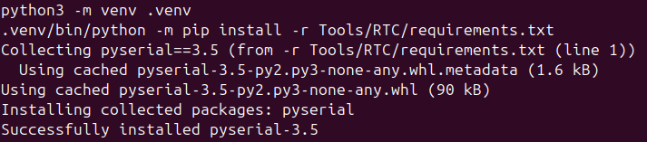


Соберем прошивку:

```bash
cmake -S Port/STM32F446RE -B build-mcu
cmake --build build-mcu
```

После выполнения процедуры прошивки подключим прошитый микроконтроллер к хост-машине и выполним установку времени RTC через Python-скрипт:

```bash
.venv/bin/python Tools/RTC/rtc-set.py --port /dev/ttyACM0
```

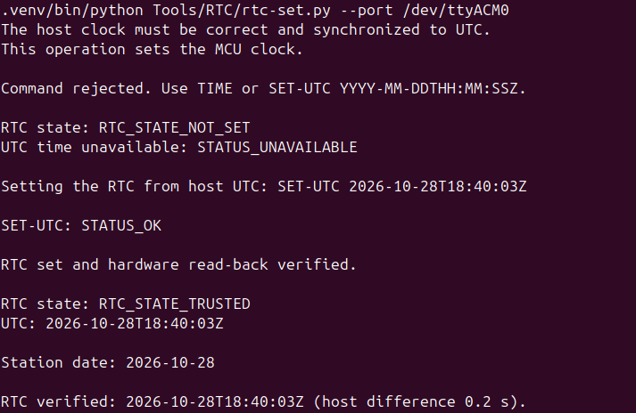

Теперь откроем Minicom-терминал.

```bash
minicom -D /dev/ttyACM0 -b 115200
```

Сделаем аппаратный сброс, чтобы увидеть стартовое сообщение от микроконтроллера. Проверим установленное время через команду `TIME` (стоит напомнить, что команда вводится "невидимой печатью" и не отображается на экране пользователя). Мы можем сделать несколько аппаратных сбросов, чтобы убедиться в том, что часы RTC действительно идут в нужном темпе.

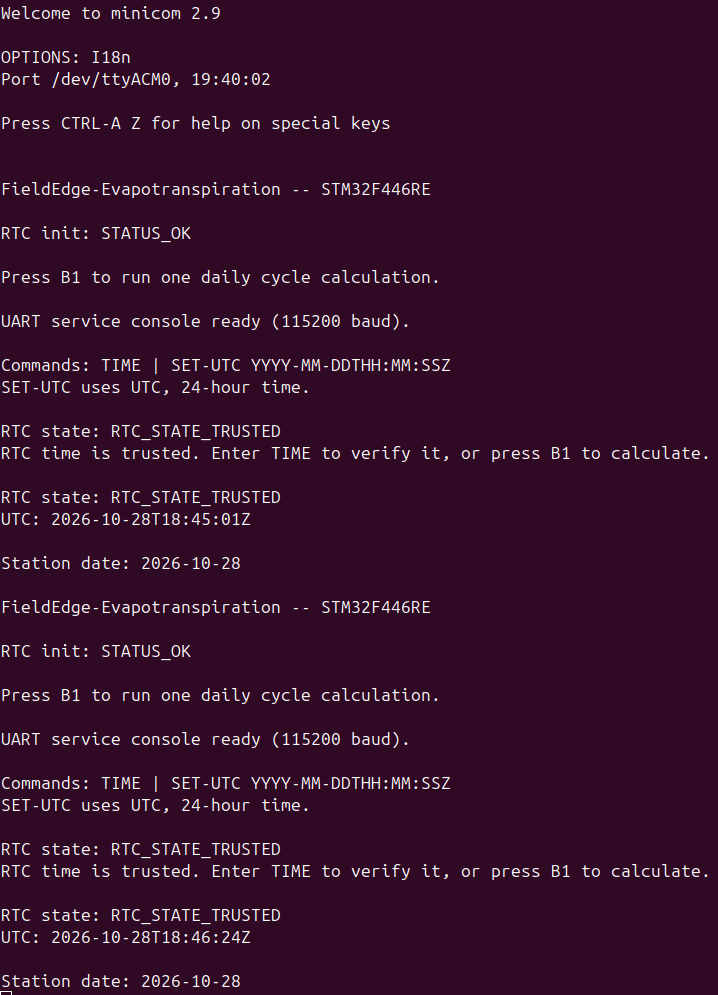

Можем запустить вычисление, нажав на пользовательскую кнопку B1, как предложено в сообщении терминала:

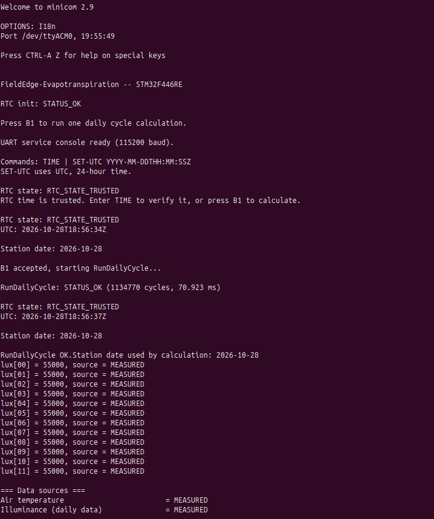  
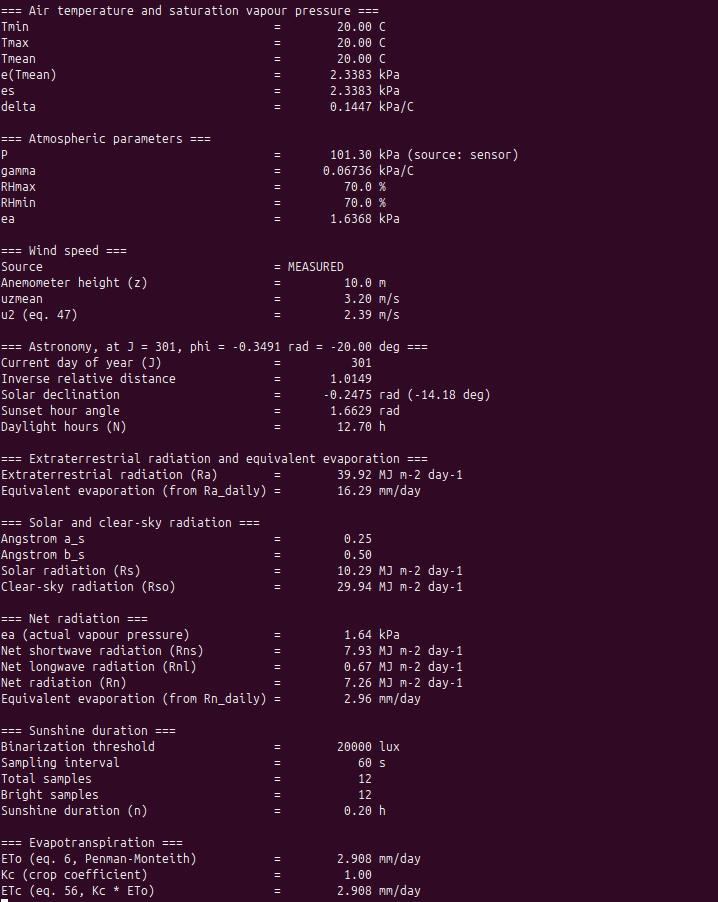

* * *

## Исправления в драйверах RTC, GPIO и консоли

Согласно [STM32F446xC/xE device errata (ES0298 Rev 8 2025)](https://www.st.com/resource/en/errata_sheet/es0298-stm32f446xcxe-device-errata-stmicroelectronics.pdf) были проведены две замены в коде модулей `rtc.c` и `service-console.c`.

- **ES0298 2.2.9:** учтена задержка при изменении защиты резервного домена `DBP`; добавлено чтение `PWR->CR` после установки и снятия защиты.

- **ES0298 2.2.10:** учтено возможное влияние переключений PC13 на LSE; управление кнопкой B1 заменено UART-командой `RUN`.

- **ES0298 2.10.2:** учтена специфика чтения теневых регистров RTC; после чтения `SSR` добавлено чтение `DR` для предотвращения блокировки.

После указанных изменений выполнены заново сборка прошивки и проверка ее работы на целевой плате с использованием команды `RUN`:

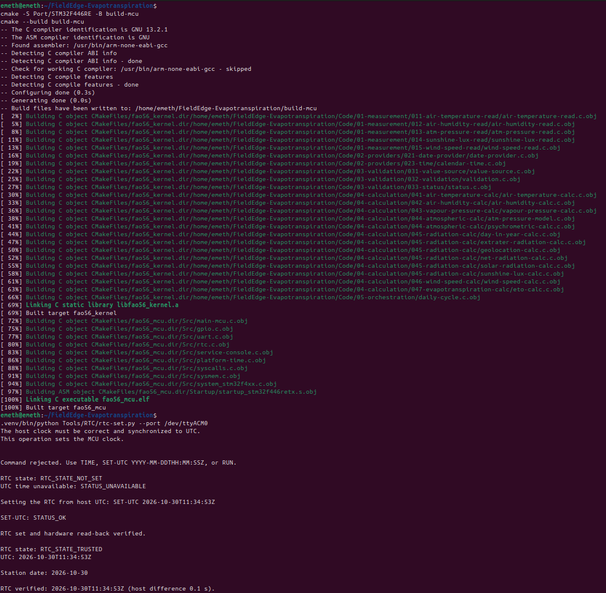  
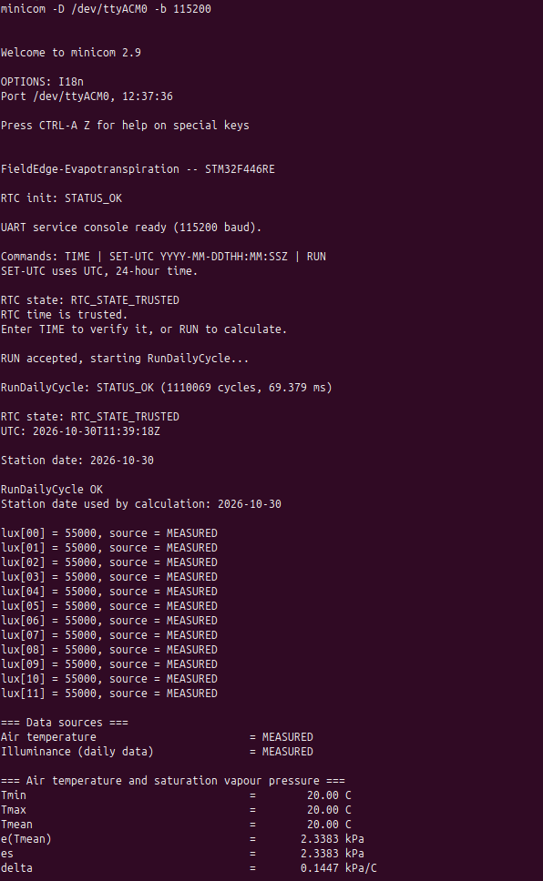  
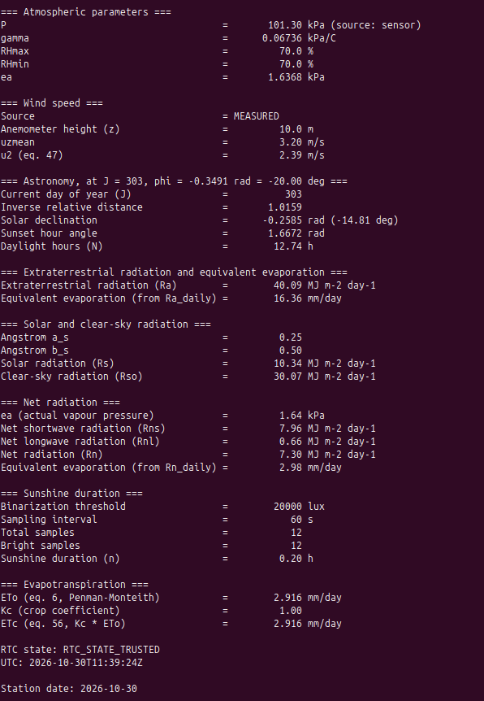
