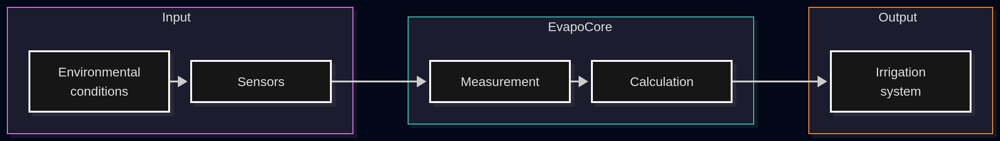

# System context

## Scope

The system operates at the edge, acquiring agrometeorological data from sensors, processing and validating the measurements, and calculating reference evapotranspiration (ETo). The resulting ETo value is provided to an external irrigation system for local irrigation decision-making and control. Version v0.1.x implements computation pipeline on a PC using emulated sensor data. Version v0.2.x is an initial bare-metal validation on the STM32F446RE.

* * *

## System context diagram

* * *

## Related documents

* [`Software architecture diagram`](software-architecture-diagram.md).  
* [`Verified call graph`](verified-call-graph.md).  
* [`Data flow specification`](data-flow-specification.md).  
* [`Doxygen source documentation`](https://cloclacordis.github.io/evapocore).  
* [`README`](../README.md).
